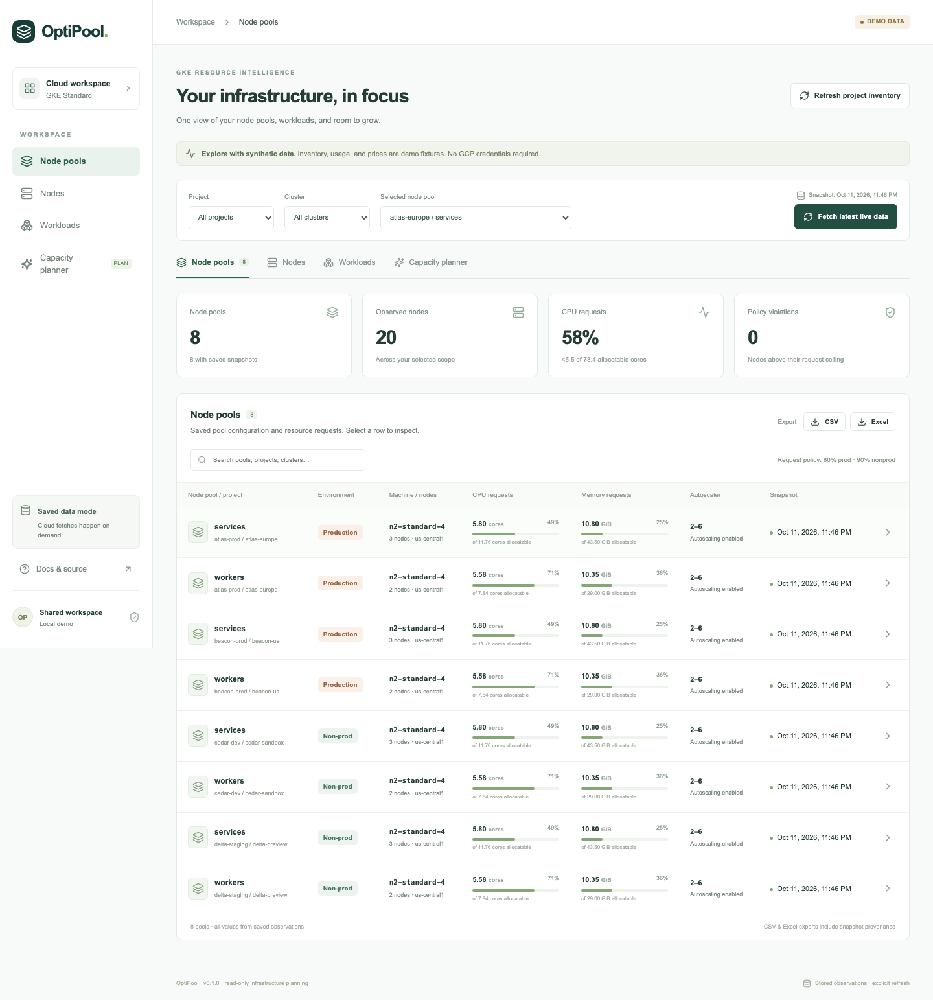

# OptiPool

**Understand GKE capacity before deploying your next service.** OptiPool saves node-pool observations in SQLite, makes requests and usage visible, and estimates placement and incremental node cost without changing infrastructure.

The local demo works without Google Cloud credentials. This first release includes real read-only collectors; a service account and a nonproduction validation are required before production rollout.



See the [architecture diagram](docs/architecture.md) for collection, persistence and estimation boundaries.

## Run locally

Prerequisites: Python 3.13+, Node.js 22+, npm. Helm 3.17.3, Docker, kubectl and Kind 0.27.0 are needed for deployment tests.

```bash
git clone git@github.com:gauravbhainsora/OptiPool.git
cd OptiPool
bash scripts/dev.sh
```

Open **http://127.0.0.1:8000**. On the first launch, eight synthetic pools across four projects are imported. Later launches reuse `data/optipool.db`. Stop the server with Ctrl+C. The demo inventory, observations, and prices are labelled synthetic.

For development with frontend hot reloading, keep the API running and use `npm --prefix frontend run dev` in a second terminal, then open http://127.0.0.1:5173.

## Dashboard

| View | What it shows |
|---|---|
| Node pools | Project/cluster/pool selection, environment, machine configuration, autoscaler bounds, saved requests, policy violations and snapshot time |
| Nodes | Readiness, cordons, allocatable CPU/memory, requests, configured limits, remaining request budgets, Pod slots, labels and taints |
| Workloads | Controller ownership, associated Services, cluster and pool replica counts, requests and highest-replica p99; a separate searchable per-Pod table shows nodes, status, requests, limits and restarts |
| Capacity planner | Simple requests/replicas or Deployment YAML; feasible placements, new nodes, growth limits and saved cost scenarios |

Node-pool, workload and Pod tables export **CSV and Excel**, with snapshot provenance. Workload exports follow the selected usage window. No export initiates a cloud fetch.

Choose **Selected node pool** before estimating. The result names the target pool, cluster and project. The planner places proposed Pods only on that pool or new nodes using its saved configuration; it does not choose another pool automatically.

The 1–10 day slider ends at the saved metrics cutoff. Deployment CPU and memory p99 are independently the highest temporal replica p99, with missing data and historical attribution gaps exposed. Costs use hourly and 730-hour monthly periods regardless of the slider.

## Saved-data contract

Initial import collects discovered pools once. After that, browsing and estimation read SQLite. **Fetch latest live data** updates only the selected pool. **Refresh project inventory** discovers accessible projects, clusters and pools without replacing existing pool snapshots; new pools need an explicit fetch. Failed core collection preserves the last complete snapshot. Monitoring and prices are optional enrichment, with failures visible.

Dynamic live project discovery uses the collector's accessible projects, with an optional allowlist. Production and nonproduction classification is explicit configuration. Requests may use at most **80% of each production node's allocatable CPU and memory**, or **90% on nonproduction nodes**. These are request ceilings, independently enforced for both resources.

## Verify and deploy

```bash
bash scripts/check.sh
bash scripts/kind-test.sh
```

The second command builds the image and installs the packaged chart in its own disposable Kind cluster. It checks HTTP flows, Helm tests, restart persistence, chart upgrades and retained storage, then removes only its own cluster. It requires a running Docker engine. These tests use no GCP credentials.

Deployment uses [charts/optipool](charts/optipool), version **0.1.0**, app version **0.1.0**. SQLite has one database-owning process and one replica on a durable block volume. The chart enforces this and uses Recreate updates. Defaults are a private demo; public ingress requires signed IAP authentication.

Read the [local testing guide](docs/testing.md), [configuration and live collector guide](docs/configuration.md), [GKE deployment guide](docs/deployment.md), [backup/restore guide](docs/operations.md), [scheduling support matrix](docs/estimation.md), and [verification evidence](docs/verification.md).

## Scope and limitations

GKE Standard is supported. This is a conservative simulator, not the Kubernetes scheduler. Node selectors, required node affinity, taints/tolerations, basic hard Pod affinity/anti-affinity, Pod slots, effective requests, existing outstanding demand and simple namespace quotas are modeled. Storage binding, topology spread, custom scheduling, admission effects and other unsupported features produce **Cannot fully assess**. Search is bounded; a found placement does not prove a minimum node count.

Live p99 covers surviving Pods within their current lifetime; deleted-replica history is not reconstructed. Current source/cadence and partial coverage are labelled. Live pricing requires an exact reviewed public SKU mapping, rather than guessed discounts. Missing prices do not prevent capacity assessment. CUD cost is a hypothetical new fully covered three-year resource commitment, not existing account savings.

Production readiness also needs real nonproduction collection validation, IAP/Workload Identity/network checks, exact pricing mappings, backup/restore validation and benchmarking at twice your actual inventory. Synthetic tests cannot establish these.

Apache 2.0 · [License](LICENSE) · [Contributing](CONTRIBUTING.md) · [Security](SECURITY.md) · [Changelog](CHANGELOG.md)
