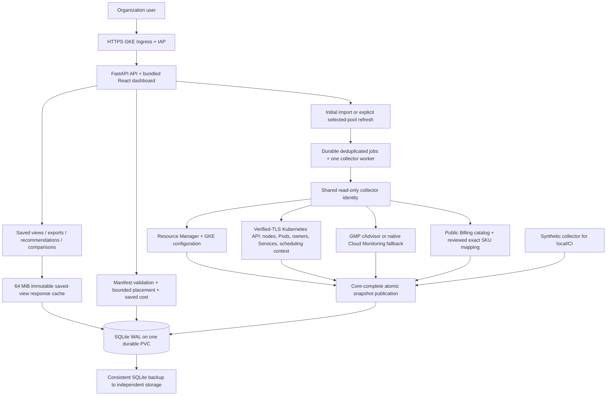

# OptiPool: architecture, requirements and build plan

Last updated: **12 October 2026**. This is the self-contained handoff for another AI or engineer. Maintain it as implementation, decisions and verification change. Status below distinguishes a released feature from unverified work in the checkout.

## 1. Start here

OptiPool is an Apache 2.0 application for understanding GKE node-pool capacity and estimating the capacity/cost impact of a proposed service. It observes infrastructure and simulates scenarios; operators make deployment and scaling changes outside the application.

Repository: `https://github.com/gauravbhainsora/OptiPool`. Active local checkout: `/Users/gaurav/Projects/OptiPool`. The original chat directory `/Users/gaurav/Projects/NodePoolOptimization` is stale; use the OptiPool checkout. No new project/repository is needed.

The user originally described four GCP projects, then chose **dynamic discovery** of projects accessible to the collector. Real project IDs and a collector service account have not been supplied. Local development uses synthetic fixtures. All intended organization users share access to the dashboard; production browser identity is checked through IAP, while a shared collector identity reads cloud resources.

### Current work and next steps

The user authorized the fixes, all suggested features, Docker Desktop cluster testing, performance improvements, committing/pushing the completed work and publishing a new release after verification. **v0.2.0 is published**. Subsequent dashboard selection/export changes and Matt Pocock skill setup are verified locally and remain unreleased; use the next-session checkpoint below.

| Work | Current status | Evidence / remaining work |
|---|---|---|
| Post-v0.2 dashboard updates | Verified locally, pushed, unreleased | Memory requests overview, pool-only dropdown labels, exact cluster identity, All node pools combined Nodes/Workloads/Pods and pinned CSV/XLSX; 74 backend cases and 4 browser flows |
| Post-v0.2 Docker Desktop / Kind lifecycle | Passed locally | Current image/chart installed; pool/cluster HTTP views and pinned exports passed; restart + temporary upgrade preserved exact snapshot IDs; uninstall kept PVC and disposable cluster removed |
| Portable A–Z implementation prompt | Written and reviewed | docs/IMPLEMENTATION_PROMPT.md is self-contained for rebuilding/continuing with another AI; maintenance instructions keep it aligned with this plan |
| Source publication for current changes | Pushed and verified | Remote main matches local 4deec62250a8dbf546b13e2b3f8941a9518f0217; exact feature/prompt/checkpoint commits published through authenticated Git data API after direct SSH/HTTPS transport errors. No new release attempted |
| Multi-service capacity planner | Verified locally, publication pending | Up to 20 services assessed jointly against one pinned pool snapshot; shared budgets, aggregate quotas/peak bounds, per-service placement and saved combined costs; covered by 81 backend tests and 6 browser flows |
| New node-pool design tab | Verified locally, publication pending | Design only; compare up to 10 pinned observed profiles, empty proposed pool, saved costs, JSON download/history and retention of every supporting snapshot; synthetic Docker/Kind and benchmark verified |
| Matt Pocock repository setup | Applied and verified | Approved AGENTS.md section and three docs/agents files; all five default GitHub triage labels exist, existing wontfix retained |
| v0.1.0 original dashboard and distribution | Released | Immutable artifacts remain available; section 10 |
| Nullable manifest resources and CUD eligibility fixes | Verified locally and in CI | Domain, HTTP and browser cases cover null/invalid fields and Not applicable/Unavailable/valid zero quotes |
| Request recommendations | Verified locally and in CI | Configurable headroom, sampled peak floor, actual selected-replica deltas, sparse/missing coverage and OOM/restart guards |
| Richer Pod drill-downs and exports | Verified locally and in CI | Saved latest usage/p99, timestamps, container resources and captured status evidence; window/snapshot-pinned CSV/XLSX |
| Rollout/HPA/zone scenarios and explanations | Verified locally and in CI | Peak bounds/rounding, hard spread/domains, before/after budgets, placement/rejections and freshness; browser flow passes |
| Saved-snapshot comparisons | Verified locally and in CI | UID identity, resource/status changes, cross-pool rejection and no collection on read |
| Fetch/loading optimization | Verified locally and in CI | Single-query inventory, bounded immutable response cache, compact planning core, four concurrent cloud reads, scoped GMP batches and exact freshness checks |
| Application/build/browser/style checks | Passed locally and in CI | **71 backend tests, 3 browser flows**, TypeScript/Vite, Ruff, Prettier and Helm lint/render/schema checks |
| Docker Desktop / Kind v0.2.0 lifecycle | Passed locally | Matching 0.2.0 image/chart installed; HTTP analytics/scenario smoke, Helm tests, restart and temporary 0.2.1-lifecycle.1 upgrade retained exact IDs; uninstall kept PVC; disposable cluster removed |
| Live nonproduction/GKE acceptance | Pending operator prerequisites | Service account/access/networking, actual metrics/prices, IAP, backups and inventory-sized load |
| v0.2.0 publication | Released and verified | Commit `f6439f3`, tag `v0.2.0`; release workflow `38169391627` and main verification `38169367740` passed; public Helm pull/release checksums and anonymous AMD64/ARM64 image manifest verified |

Latest post-v0.2 synthetic benchmark: 20 concurrent users, 16 pools, 40 nodes and 160 Pods; saved-view p95 **0.213s**, combined two-pool cluster p95 **0.243s**, estimate p95 **0.070s**, service-bundle p95 **0.056s** and two-profile new-pool design p95 **0.147s**, zero cloud calls during the workload. These are fixture measurements, not live network/IAP or actual-inventory acceptance. Performance varies by load and machine; no claim of globally optimal scheduling or fastest possible collection is made.

## 2. Agreed requirements and invariants

1. Discover projects, GKE Standard clusters and node pools dynamically; provide optional project allowlisting and project/cluster/pool selection. Cluster selection uses project + location + cluster identity; the selected-pool input displays only the pool name. “All node pools” requires a specific cluster and combines saved Nodes, Workloads and Pods. It never starts bulk refresh; capacity planning requires an individual pool.
2. Show node-pool inventory, individual nodes, controller/service-associated workloads, individual Pods and a capacity planner.
3. Initial import saves observations once. Later dashboard reads, slider changes, exports, recommendations, comparisons and estimates use the database.
4. **Fetch latest live data** refreshes only the selected pool. Supporting cluster context is attached to that snapshot without replacing other pools' snapshots. Inventory discovery is a separate explicit action and preserves saved observations.
5. Publish a snapshot atomically only after required core collection succeeds. Failed refreshes retain the last complete snapshot. Optional metrics/pricing failures remain visible as missing data.
6. Production request ceilings are **80%**, and nonproduction ceilings **90%**, independently for each node's allocatable CPU and memory. This is a requests policy, not actual usage utilization or container limits.
7. Existing Pods remain fixed during simulation. Account for Pod slots, effective init/sidecar/overhead requests, required selectors/affinity, taints and outstanding pool-bound demand. Unknown scheduling/admission/storage behavior makes results conditional.
8. Proposed workloads have user-supplied requests and replicas, or one apps/v1 Deployment manifest. The user selects the target pool; results name its project, cluster and pool.
9. Workload p99 means the highest temporal replica p99, independently for CPU and memory, shown for Deployments. Never substitute average or combined-sample p99.
10. The metrics slider covers **1–10 saved days**, ending at the saved cutoff, not the current clock. Missing usage is unavailable rather than zero. Historical ownership and deleted-replica gaps are disclosed.
11. Costs include saved on-demand and **three-year resource-based CUD** component prices. Use USD, hourly and 730-hour monthly comparisons, boot disks separately, with a disclosed commitment obligation. Existing account coverage/credits/tax/negotiation are outside scope.
12. Node-pool, workload and Pod tables export CSV and XLSX, with provenance and safe formula escaping. Exports never fetch cloud data.
13. SQLite has one process owner and persistent block storage. Horizontal database-owner replicas are outside the current architecture.
14. Open-source distribution includes Apache 2.0, contributor/security guidance, local dummy-data testing, a Docker image, versioned Helm chart, deployment/backup instructions and reproducible checks.
15. Preserve this file as the handoff. Update it after material implementation, new decisions, test results, blockers and publication changes. Keep credentials and real/private observations out of it.

## 3. Architecture and data flow



The API/UI and database owner are one deployed instance. A single background collector worker makes network calls outside SQLite transactions. Durable jobs and audit records survive restarts; interrupted jobs fail visibly rather than silently publish partial data. Each estimate pins an immutable snapshot. Read-only analytical endpoints do not enqueue jobs.

### Frontend

React 19, TypeScript strict, Vite, local fonts and Lucide icons. API serves the built UI. Tabs: Node pools, Nodes, Workloads, Capacity planner, New node pool. Project/cluster filters and selected-pool control supply context. Workloads has the 1–10 day slider, workload rows and a searchable/paginated individual-Pod table. CSV/XLSX downloads use saved API exports. Node Pools has separate CPU and memory request percentages calculated from total saved requests divided by total allocatable resources in the filtered scope, with missing denominators shown unavailable. Layout supports desktop and mobile. The All node pools view preserves per-pool capture times, coverage and environment budgets; it does not imply simultaneous observations. Individual-pool recommendations, timelines, comparisons and capacity estimates stay scoped to that pool.

### Backend modules and seams

- `backend/optipool/app.py`: API, identity dependencies, lifecycle, job orchestration and static assets.
- `config.py`: demo/live modes, IAP audience, environment hierarchy, bounds, price mapping and production acceptance gate.
- `store.py`: SQLite ownership, inventory, compressed immutable snapshots, atomic overviews/compact planning cores, jobs, estimates, audit, retention and backups.
- `views.py`: byte-bounded LRU cache of serialized views keyed by immutable snapshot ID, day window and minimum sample threshold; deduplicates simultaneous cold reads.
- `collector.py`: read-only cloud/Kubernetes REST discovery, normalization, metrics and pricing; lazy ADC initialization keeps cached reads working during credential outages.
- `demo.py`: synthetic project/pool/node/Pod/usage/price fixtures; no GCP access.
- `resources.py`: Kubernetes quantity parsing, effective Pod requests/limits, selectors and node eligibility.
- `manifests.py`: local manifest-shape validation and normalization with field-specific input errors (implemented).
- `estimator.py`: single-service/service-bundle normalization, aggregated namespace quotas and peak bounds, shared placement, per-service explanations and saved cost.
- `pool_design.py`: saved observed profile projection and empty-pool candidate designs, certainty/quoted-price ranking and immutable review configuration.
- `topology.py`: hard topology-spread evaluation over saved cluster context and planned nodes (implemented).
- `metrics.py`: saved-window aggregation, independent highest-replica p99 and per-Pod summaries.
- `recommendations.py`: advisory effective Pod request proposals and review guardrails (implemented).
- `comparison.py`: same-pool immutable snapshot comparisons (implemented).
- `cluster_views.py`: combine immutable saved pool views for an exact cluster; preserve source snapshots, group controllers and build provenance-bearing workload exports.
- `pods.py`: selected-pool Pod rows, spec/resources and available saved status detail.
- `pricing.py`: component costs, eligibility, missing-price status and commitment obligation.
- `exports.py`: CSV/XLSX generation, provenance and formula safety.
- `auth.py`: signed IAP assertion validation; trusted local mode is only for private development.

## 4. Collection, identity and monitoring

Production uses a shared service account through Workload Identity, independent of the browser user's identity. Local approved live testing uses ADC: `gcloud auth login` and `gcloud auth application-default login` serve distinct purposes; approved service-account impersonation can supply ADC. Synthetic development requires neither command.

Project discovery uses Resource Manager projects.search for accessible ACTIVE projects, then GKE Standard clusters/pools. Required Kubernetes core reads cover Nodes, Pods, namespaces, Services, Deployments, ReplicaSets, StatefulSets, DaemonSets, Jobs, CronJobs, quotas, LimitRanges, PV/PVC and StorageClasses. Current owner traversal maps Pod → ReplicaSet → Deployment where available; Service selectors are associations, not ownership. Optional admission inspection flags uncertainty. GKE Autopilot and DNS-only control-plane endpoint support are outside the current adapter scope.

The operator provisions project visibility, GKE read permissions, monitoring access and Kubernetes list/get rights for the target clusters. Hosting the application does not automatically grant those permissions. Cluster CA verification and network reachability are required.

Independent project/resource reads run concurrently, with at most four active collector HTTP GETs. Each worker owns its AuthorizedSession/connection pool; credential refresh is serialized. Transient GET failures retry at most twice with backoff and Retry-After handling. Resource continuation pages stay sequential; any required list failure prevents publication. Metrics and pricing enrichment overlap but remain optional. GMP queries are scoped to observed selected-pool Pods, grouped by namespace and batched to at most 100 names and 3,000 encoded regex characters, keeping request URLs bounded. Native fallback still reads cluster-filtered time series before selected-pool attribution. No network response cache can override an explicit refresh.

GMP queries saved ten-day ranges of CPU `rate(container_cpu_usage_seconds_total[5m])` summed by namespace/Pod and working-set memory, sampled every 300 seconds. Native fallback uses CPU ALIGN_RATE and non-evictable memory ALIGN_MEAN at the same cadence. Demo cadence is 1,800 seconds. Definitions/source/cadence must remain explicit.

Attribute usage to currently observed Pod UID, lifetime, bound node/pool and owner evidence. Omit earlier-lifetime samples, including CPU rate windows crossing Pod creation. Deleted Pods and earlier ownership/pool history are not reconstructed. New Pod detail may use existing saved samples, but per-container usage and CPU throttling history are not currently collected; show unavailable rather than invent values. Saved Kubernetes container termination/condition evidence is added on future explicit refreshes; older snapshots can lack it.

## 5. Persistence, APIs and configuration

SQLite schema version 1 contains `metadata`, `inventory`, `snapshots`, `snapshot_overviews`, `snapshot_core`, `jobs`, `estimates`, `estimate_details`, `estimate_sources`, `audit` and schema metadata. Snapshot/estimate payloads use compressed JSON. WAL, foreign keys, busy timeout, an in-process lock and a file ownership lock protect access. Inventory/pool lookup uses one indexed SQL query and decodes only compact overviews outside the connection lock. Pool exports use those overviews. Estimate packing and history decoding also happen outside the SQLite lock. Serialized view caching is capped at 64 MiB and keyed by immutable IDs rather than a TTL; selecting latest checks SQLite each time. Auth remains evaluated before serving cached bytes. Oversized views bypass caching; in-flight calculations/decoded objects are not covered by the cache byte cap. The UI debounces day-window changes by 150 ms and cancels obsolete requests.

Retention is 30 days, preserving the latest pool snapshot and snapshots pinned by retained estimates. SQLite backup API creates a consistent file; copying a live DB independently of WAL is not a backup. Keep off-volume backups and test restore. The new `snapshot_core` table is an additive derived projection published in the same transaction as the full snapshot; it omits metrics histories so estimation/comparison do not repeatedly parse them. Older rows fall back to the original payload; no automatic collection or destructive rewrite occurs. The new estimate_details classification and estimate_sources reference tables are also additive; estimates and all supporting profile snapshot references are saved atomically. Retention preserves every referenced snapshot while its design is retained. Legacy estimates still use their anchor snapshot and are treated as capacity estimates. Saved design history uses one cluster-scoped SQL query; ordinary estimate history excludes designs before its 20-row limit. Backup/restore and post-retention references are tested. Added job/history indexes are also additive. Schema version remains 1; backup/restore is still required before upgrade. Older applications ignore derived tables but do not understand new design record kinds or all supporting snapshot references. Rollback requires a compatible pre-upgrade backup/restore plan; Helm rollback is not a database rollback.

Existing API groups: inventory/snapshot reads; explicit inventory and pool refresh; job status; estimate/history; CSV/XLSX exports; health/readiness. New read-only routes: `/api/recommendations`, `/api/snapshots` and `/api/snapshots/compare`. Comparisons must verify both IDs belong to the selected pool. Recommendations and workload/Pod exports can pin `snapshot_id`; the UI uses this to match displayed data even if another viewer refreshes the pool. API authentication applies to new routes. Health endpoints expose no inventory. Unreleased `/api/cluster-snapshot` GET reads the latest saved IDs in one inventory query, then reuses cached individual saved views. `/api/export-cluster/{workloads|pods}` POST is read-only: JSON pins the displayed pool IDs to snapshot IDs, validates cluster/pool membership and exports CSV/XLSX without creating jobs. Node-pool exports also filter location. The combined table APIs introduce no new schema or collection behavior. New planner APIs: `/api/estimate-bundle` POST, `/api/node-pool-profiles` GET, `/api/node-pool-design` POST and `/api/node-pool-designs` GET. Single/bundle estimates accept a validated optional snapshot_id; the UI pins its displayed snapshot and cancels obsolete results on pool change. Profiles/designs use compact saved cores, validate exact cluster and snapshot membership, and never collect or provision. Analytical reports are saved to existing estimate storage with the additive reference/classification tables.

Configuration defaults: demo/local auth, `data/optipool.db`, empty project allowlist (dynamic discovery), production environment default, min 20 samples, max 100 added nodes (configurable up to 500), max 2,000 simulated replicas, and production collection gate disabled. Hierarchy: pool override → cluster override → project override → default. Demo and live use separate databases. Peak scenario replicas must respect simulation bounds.

Private config comes from `OPTIPOOL_CONFIG` (default `config.local.yaml`); MODE/AUTH_MODE/IAP_AUDIENCE/DATABASE environment overrides exist. Put local DBs, credentials, real environment configuration and backups outside Git. IAP assertions require verified ES256 signature, issuer, audience, identity and bounded lifetime; unsigned email headers do not authenticate a user.

## 6. Capacity and cost semantics

Per-node remaining budget is allocatable × environment factor − existing effective requests, for CPU and memory separately. Limits and measured usage do not replace requests. Account for effective init peaks, restartable sidecars, overhead, limit-only defaulting, Pod slots, readiness/cordons, node selectors, required node/Pod affinity and taints. Definite pool-bound pending Pods/unmaterialized controller demand are considered before proposed Pods; ambiguous cross-pool competing demand is conditional.

New nodes use saved observed allocatable prototypes and conservative DaemonSet/static/system overhead by zone. Empty pools without a verified prototype cannot supply a confident growth count. Autoscaler permitted growth is reported independently of estimated required nodes; the app makes no scaling changes.

Placement is bounded greedy search. A found assignment is feasible under stated assumptions, not a proven minimum or Kubernetes scheduler scoring prediction. Search exhaustion does not prove infeasibility. Outcomes: Fits, Needs nodes, Blocked constraints, Cannot fully assess. Unsupported storage/admission/custom scheduler/RuntimeClass/DRA/extended resources and incomplete context remain conditional.

New scenario options evaluate explicit HPA maximum and rollout-surge headroom; they model **additional proposed demand while existing Pods stay fixed**, not replacement or full update sequencing of an existing controller. Percentage surge rounds up. Terminating Pods, preemption and availability during failures are outside this peak-envelope model. Simple zone spreading adds a hard zone constraint; YAML hard topology constraints use saved cluster-wide matching Pods and domain inclusion policies. Dynamic label keys remain conditional; soft spread scoring is not reproduced.

Node explanations should show before/after requests, policy ceilings, remaining budgets, proposed assignments, zone totals and the reason another proposed Pod cannot fit. Confidence/freshness should remain separate from actual scheduling guarantees.

Public prices require reviewed exact region/machine/provisioning/disk/component SKU mappings and units. Missing complete mappings mean unavailable. No guessed percentage CUD discounts. If no components are eligible, CUD is Not applicable; if eligible commitment prices are absent, it is Unavailable. Valid zero cost is not missing data. Monthly charges use 730 hours; hypothetical eligible commitment obligation uses hourly × 24 × 365 × 3. Existing commitments, credits, negotiated rates and bills are not modeled.

## 7. New product features and acceptance details

### Combined cluster observations (unreleased)

Selecting All node pools combines saved node and Pod rows with pool identity and snapshot provenance. Controllers group by namespace/kind/name; selected-pool replicas and requests/limits are summed, Services unioned. Desired/running cluster totals are not summed across pool snapshots. Deployment p99 is the maximum of the per-pool highest-replica p99 independently for CPU and memory, with winner pool/replica retained in exports. The 1–10 day window ends at each pool's saved cutoff. Missing pool/metric coverage is disclosed; incompatible memory definitions withhold a combined memory p99. Observations can describe different times and may repeat a Pod that migrated between captures; this view is not a simultaneous cluster census. Exports pin displayed snapshot IDs even if a later refresh occurs. Missing snapshots do not trigger collection.

Non-Deployment controller rows (for example SparkApplication and DaemonSet) display “Deployments only” with their workload kind / a pointer to individual Pod metrics. This is the agreed controller p99 scope, not evidence that Pod metrics were absent. Per-Pod metrics remain available when attributable samples were collected. Broader controller aggregation is not implemented.

### Service bundles and new-pool designs (unreleased)

Capacity planner supports 1–20 services, each with simple resources or one Deployment YAML and individual peak/HPA/surge/zone inputs. Total peak replicas are bounded by max_replicas, not independently multiplied by service count. Same-namespace quota demand is aggregated; existing pool-bound demand is placed first. All services share one simulation and remain identifiable in placements, resource totals and per-service rejections. User order remains the bounded greedy search order, with alternate-assignment uncertainty disclosed. Duplicate namespace/name pairs are rejected. Legacy single-service API/forms/history remain compatible.

New node pool is a design-only tab. It derives the selected cluster from explicit cluster selection or the selected individual pool's context. Users enter a new lowercase pool name (application bound 40 characters), environment and service bundle, then select up to 10 available saved observed profiles. Candidates clone saved templates with the proposed pool label, use an empty pool with the selected environment ceiling, and preserve existing cluster Pods/nodes as scheduling context. Existing pool-bound pending demand is excluded. Quotes keep exact saved machine/provisioning/disk data. Ranking prefers complete modeled assignments, fewer unknowns, then lowest available on-demand quote; unquoted profiles may be cheaper. Missing templates/prices stay unknown. Different source times, inherited labels/taints/overhead and new-pool DaemonSet/IP/Compute-quota/regional placement/admission requirements are disclosed. This is not the full machine catalog or an executable GKE create request. Reports include complete submitted inputs (including manifests), proposed per-zone configuration, profiles, placements, costs, assumptions and snapshot references; JSON download and cluster-scoped saved history are available. Loading a design restores its service/name/environment inputs; reassessment uses the currently selected loaded profiles, while the historical report retains its original snapshot provenance. Every supporting snapshot is pinned by retention. No GKE resources are created.

### Right-sizing

Use the selected saved window and highest-replica p99. Headroom is user-configurable (default 20%, distinct from the 80%/90% per-node request ceiling). Proposals are effective Pod requests, not an automatically generated per-container manifest. Round resources sensibly; memory proposal has observed sampled peak as a floor. Display current/proposed requests, signed capacity delta across saved pool replicas, source/coverage and evidence warnings. Missing adequate samples means no proposal for that resource. Restarts/OOM evidence withholds memory reductions. Unknown throttling and historical coverage prevent a safety claim. Heterogeneous replicas require template review. Changes are advisory only.

### Pod drill-downs

Show per-Pod p99 and latest saved usage with sample timestamps/coverage, plus container request/limit breakdown, readiness/scheduling conditions and available OOM/termination/restart evidence. Maintain existing search, pagination and all-filtered-row exports. Carry selected window and provenance into usage exports. Do not describe a saved/latest sampled value as current live usage.

### Snapshot comparisons

List retained saved snapshots for the selected pool. Compare two explicit IDs, including node/Pod/workload additions/removals, changed requests/limits/status/placement, and total nodes/Pods/CPU/memory deltas. Use Pod UID for identity and namespace-qualified workload IDs. With only one snapshot, explain that another explicit refresh is needed; do not generate synthetic history or fetch automatically. Display sampling/snapshot times and treat differences as observation changes, not proof of causation.

### Planner scenarios and visualization

Keep steady mode default. Optional HPA, rollout and combined modes show base/HPA/surge/peak replica counts; validate peak bounds before simulation. Preserve immutable inputs/snapshot in estimate history. Render node assignments and budgets for both existing/planned nodes, with reason categories separating resource shortage, constraints and incomplete evidence. Include zone spread and autoscaler limits without implying automatic changes.

## 8. Implementation sequence

1. Reproduce/fix the null-resource and no-eligible-CUD bugs; add domain and HTTP/UI regression coverage.
2. Finish per-Pod saved metrics/status and export fields, recommendation coverage/guards and authenticated read-only APIs.
3. Finish/verify peak scenario bounds, surge rounding, topology spread behavior and per-node explanations.
4. Build dashboard components for recommendations, richer Pod detail, comparison controls and visual assessment.
5. Add meaningful tests covering missing/sparse data, OOM/restarts, invalid nested manifests, peak limits, topology domains, cross-pool comparison rejection and no-collection-on-read behavior.
6. Run applicable complete backend/style/build/browser checks. Run the actual chart install/restart/upgrade test and measure performance after new calculation paths. Fix regressions before recording completion.
7. Update this file, feature docs and changelog with exact evidence and limitations. Update app/chart/image versions together for any new release; keep old archives/tags immutable and retain old index entries.
8. Report the reviewable local result and publication status. Live acceptance remains separately pending the operator prerequisites.

## 9. Verification and local continuation

From the existing checkout, use Python 3.13+, Node 22+, Helm 3.17.3, Docker, kubectl and Kind 0.27.0. Start demo with `bash scripts/dev.sh`; API/UI at `http://127.0.0.1:8000`. Existing local preview may already own `data/optipool.db`; use an isolated database/port for tests instead of starting a second owner on that file.

Useful checks:

```bash
.venv/bin/pytest -q
bash scripts/check.sh
npm --prefix frontend test
.venv/bin/python scripts/benchmark.py
bash scripts/kind-test.sh
```

The browser runner uses an isolated demo DB and port 8100, tests desktop/mobile, and writes synthetic screenshots. The Kind script creates/removes only its own cluster and uses explicit contexts; local-built images must override the chart's GHCR repository. Latest post-v0.2 synthetic benchmark used 20 concurrent users, 16 pools, 40 nodes and 160 Pods, with saved-view p95 about 0.213s, two-pool combined cluster p95 about 0.243s, ordinary estimate p95 about 0.070s, bundle p95 0.056s and two-profile design p95 0.147s. Docker lifecycle verification was running concurrently on the host; these measurements are not directly comparable to the released v0.2 benchmark (0.135s / 0.071s). This is not a live-inventory or network/IAP acceptance result. Target actual acceptance: 20 users at twice discovered inventory, cached views p95 <2s and ordinary estimates <10s.

Real acceptance must check collector IAM/RBAC, control-plane networking, actual normalization/ownership, GMP/native definitions and sample coverage, exact prices, HTTPS/IAP/audience/Workload Identity, off-volume backup/restore, and actual inventory-sized load. Keep production collection gated until results are recorded.

## 10. Published distribution and release discipline

Released app/chart version: **0.2.0**, immutable source tag `v0.2.0` at commit `f6439f3d9606ff0c39f092b9356fed11f5c27b6a`. Public release: `https://github.com/gauravbhainsora/OptiPool/releases/tag/v0.2.0`. Release workflow `https://github.com/gauravbhainsora/OptiPool/actions/runs/38169391627` and main verification `38169367740` succeeded. Chart SHA256: `4fffdebf28d4ba6bd015fd1bbbcbdffb7d2cfbd26c31fbbc54fa7da331332730`. Public multi-platform image digest: `sha256:5cbcc2a5a27c34a49d555a8310a09cdda63b790be0033e1441710c79216897c3`.

Anonymous `helm repo add/update/pull` verified both 0.2.0 and unchanged 0.1.0 archives. Release archive/checksum and image-digest assets match the public artifacts. Anonymous GHCR index access includes Linux AMD64 and ARM64. This verifies distribution and synthetic test gates, not live production acceptance.

```bash
helm repo add optipool https://raw.githubusercontent.com/gauravbhainsora/OptiPool/main/docs/helm
helm repo update
helm pull optipool/optipool --version 0.2.0
docker pull ghcr.io/gauravbhainsora/optipool:0.2.0
```

Previous release remains immutable: `v0.1.0`, source `25a2d95`, publication documentation `909f725`. Public release: `https://github.com/gauravbhainsora/OptiPool/releases/tag/v0.1.0`. Chart archive SHA256: `13791f414e33176ee08060db50a73fd6c4047582b5d4741704d088e96479a309`. Multi-platform image digest: `sha256:e4ba2ca19c82aeb24183510d830850bfd8856830a26c753955574070f12056f2`. Linux AMD64/ARM64 anonymous access and release asset checksums were verified. Release workflow run `38165629349` passed.

Helm repository index is `docs/helm/index.yaml` on main, with version-tagged package URLs. The checked-in chart archive is intentionally tracked. Tag-triggered release workflow first reuses full CI, verifies the archive against source and checksum, builds/pushes the image through the scoped Actions token, then publishes GitHub release assets and digest. New GHCR packages initially require an owner visibility setting; existing OptiPool image is public. No personal token is stored in the repo.

Helm uses one replica/worker, Recreate updates, nonroot user 10001, a read-only root filesystem, temporary volume, health/readiness probes and a durable RWO PVC (default 20Gi). Default service is private ClusterIP/demo; ingress requires IAP audience, existing HTTPS certificate/domain and OAuth secret. Configure Kubernetes ServiceAccount/Workload Identity externally approved grants. Default PVC survives uninstall; Kind cluster deletion removes its local volume regardless. Future schema migration/rollback requires explicit data compatibility and restore tests.

## 11. Next-session checkpoint

The feature source commit is `f6439f3d9606ff0c39f092b9356fed11f5c27b6a`, on main and tagged v0.2.0. Release workflow: `https://github.com/gauravbhainsora/OptiPool/actions/runs/38169391627`. Main verification: `https://github.com/gauravbhainsora/OptiPool/actions/runs/38169367740`. Both workflows passed. The release, public chart downloads/checksums and anonymous multi-platform image manifest were verified. The final documentation checkpoint is pushed after this verification; `git log` identifies its commit separately from the immutable feature tag. The localhost:8000 preview serves v0.2.0 from the existing saved demo DB. No real credentials or observations were supplied or collected.

The post-v0.2.0 checkout adds memory requests in the overview, pool-only dropdown names, exact cluster identities, combined Nodes/Workloads/Pods and pinned exports for All node pools, and clearer non-Deployment p99 captions. These changes pass 74 backend tests and four browser flows plus build/style/Helm checks. The current-source Docker/Kind chart install, HTTP cluster/export smoke, Helm hooks, restart persistence and temporary chart upgrade also pass; exact saved IDs persisted and uninstall retained the PVC before cluster cleanup. Versions and public release artifacts remain 0.2.0. Feature source `6f1db48`, portable prompt `e30abd0` and prior blocker checkpoint `4deec62` are now published on main with their exact original hashes. Remote main was verified at `4deec62250a8dbf546b13e2b3f8941a9518f0217` on 12 October 2026. After the user authenticated gh, direct SSH/HTTPS pushes continued failing at the transport layer; authenticated Git-data API publication with throttled large uploads succeeded, preserving blob/tree/commit hashes and updating main without force or history rewriting. No new release was attempted. Subsequent documentation commits record this success separately from feature commits.

The approved Matt Pocock setup is applied: GitHub Issues in gauravbhainsora/OptiPool; default needs-triage, needs-info, ready-for-agent, ready-for-human and wontfix labels (all verified publicly); single-context root GLOSSARY.md + docs/adr/. Existing instructions and domain docs were preserved. AGENTS.md points to docs/agents/issue-tracker.md, triage-labels.md and domain.md. Future skills such as triage/to-tickets/to-spec/domain-modeling read this configuration. These files are editable directly. Signed-in GitHub browser access was used for approved label creation. The user subsequently authenticated gh through its web flow; credentials are managed by the system keyring, and none are stored in the repository.

The next engineering work needs the operator's collector identity and approved nonproduction access: real collection/attribution/pricing validation, target-sized load and refresh measurements, IAP/Workload Identity deployment and off-volume backup drills. Avoid inventing real project IDs or billing prices. Keep using synthetic fixtures until those prerequisites arrive. Consider further scheduling/search or large-inventory changes only against measured production-scale evidence, retaining conditional outcomes for unsupported behavior.

The user also requested a complete prompt another AI can implement from A–Z. `docs/IMPLEMENTATION_PROMPT.md` contains the architecture, stack, all agreed features/contracts, phased implementation, tests and local/Docker/Helm/CI/release requirements. It works without this chat or other docs. This build plan stays authoritative for changing implementation/publication status; keep the prompt synchronized when requirements or architecture change.

The formal planner-extension spec is published as [GitHub issue #1](https://github.com/gauravbhainsora/OptiPool/issues/1), labelled ready-for-agent through the explicitly invoked to-spec skill. The user confirmed authenticated saved-data API and browser journeys as the primary test boundaries, with focused scheduling/resource/quota cases. The issue documents already implemented behavior and excludes actual provisioning; it is not an instruction to rebuild the current code.

### Planner extension checkpoint

Both newly requested features are implemented and verified locally: multi-service capacity planning and new-node-pool design/estimation. The user confirmed design only; infrastructure mutation remains excluded. Current checks: 81 backend cases, six browser flows (including stale-result cancellation on pool switch, mobile overflow, design download/history), TypeScript/Vite, Ruff, Prettier and Helm validations. Docker Desktop/Kind install, HTTP bundle/design/history smoke, Helm hooks, snapshot-preserving restart/upgrade and retained PVC passed; its disposable cluster was removed. The 20-user synthetic benchmark reports 0.056s bundle and 0.147s two-profile design p95, zero cloud collection; source publication is the next step. Public app/chart/image versions remain 0.2.0 until a separate versioned release. Git log identifies the feature/documentation commits when pushed. Existing nonproduction/GKE prerequisites remain pending.

## 12. Maintenance instructions for the next agent

Read this file before changing architecture, collection, estimation, deployment or roadmap scope. Inspect actual code and Git status to confirm the checkout state; the status table is a checkpoint, not evidence that an unrun test passes. Keep user-approved contracts intact. Continue existing authorized work instead of restarting or discarding local changes.

After every material milestone, update the date, status table, acceptance evidence, remaining work and any new limitations here. Record releases separately from local implementation. Use clear statuses: released, implemented locally, verified locally, in progress, deferred, or awaiting external prerequisite. A future AI should be able to identify what to do next without this conversation. Keep this handoff self-contained; other documents may supplement it but must not be required to reconstruct the architecture and plan.
