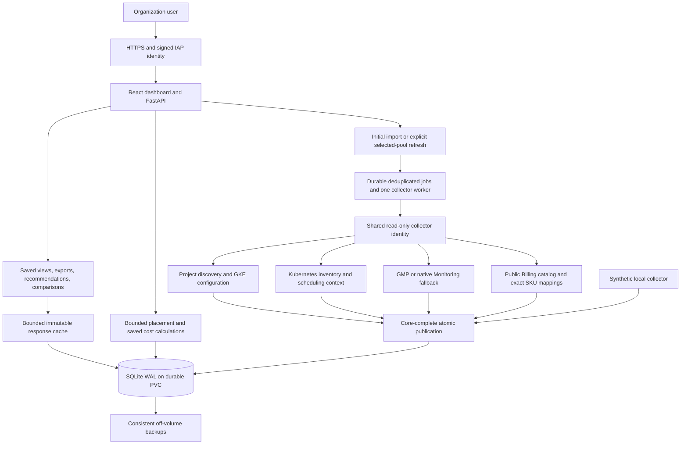

# OptiPool complete implementation prompt

Copy the prompt below into another AI to build OptiPool or continue its implementation. It is self-contained and describes the agreed product, including locally verified additions after release 0.2.0. Updated 12 October 2026. Real GCP collection, identity, prices and organization-scale performance still require operator validation.

---

You are implementing **OptiPool**, an Apache 2.0 open-source dashboard for GKE node-pool optimization and capacity/cost estimation. Deliver working software, tests, local development instructions, architecture documentation, a Docker image and a versioned Helm chart. Work through the phases below until the acceptance criteria pass. Keep implementation status and remaining operator prerequisites explicit.

If an existing checkout is supplied, inspect its instructions, architecture, source, Git status and tests first. Extend the existing implementation and preserve user work and saved databases. For this project, the repository is `https://github.com/gauravbhainsora/OptiPool`; the current local checkout is `/Users/gaurav/Projects/OptiPool`. Paths are context for continuation, not required paths for a fresh build. The existing `docs/BUILD_PLAN.md` is the maintained architecture/status handoff. This prompt supplies the requirements even when that repository is unavailable.

## 1. Product and access

Users need one place to inspect projects, clusters, pools, nodes, controller-associated workloads and individual Pods, then assess whether a proposed service fits a selected pool and estimate additional-node cost.

- Discover accessible ACTIVE GCP projects dynamically. The original example had four projects; neither project IDs nor their count is hardcoded. Support an optional project allowlist.
- Support GKE Standard clusters. Report Autopilot and unsupported control-plane endpoint types explicitly.
- Make the dashboard available to intended organization users through authenticated access. Production uses signed Google IAP identity; it does not expose inventory anonymously. Use private local authentication for development.
- Production collection uses one shared read-only service account through Workload Identity, independent of browser identity. Operator credentials and actual project IDs may arrive later; the complete local demo must work without them.
- Local live access uses ADC. Explain that `gcloud auth login` and `gcloud auth application-default login` have distinct purposes. Approved service-account impersonation can provide ADC. Keep credentials and private observations outside Git.
- The application observes and estimates. Users perform actual deployment, node-pool scaling, commitment purchases and resource changes outside it.

## 2. Architecture and technology

Use the established stack when continuing: Python 3.13+, FastAPI, Pydantic, SQLite, React 19, strict TypeScript, Vite, Lucide and locally bundled fonts. Use modular domain logic with injectable collectors and an API serving the built frontend.



Keep seams for configuration, authentication, storage/jobs, collection, Kubernetes resources, manifest normalization, metrics, pricing, estimation, topology, recommendations, Pod details, snapshot comparison, cluster aggregation and exports. Domain calculations must run against immutable saved inputs, with no hidden network reads.

## 3. Saved-data contract

1. On first import, discover and collect pools into the database. Persist initialization state so restarting does not re-import existing observations.
2. Thereafter, navigation, filtering, window changes, exports, recommendations, comparisons and estimates read saved data only.
3. **Fetch latest live data** explicitly refreshes exactly the selected individual pool. It may read supporting cluster context but publishes only that pool's replacement snapshot. Preserve other pools' snapshot IDs.
4. Provide separate explicit **Refresh project inventory** discovery. Preserve existing saved observations, including last observations for unavailable pools. New pools without observations require explicit collection.
5. Required core reads must complete before atomic publication. A failed refresh retains the previous complete snapshot. Optional metrics/pricing failures are saved as unavailable evidence rather than fabricated zeros.
6. Show loading, durable job state, failure, freshness and partial coverage. Deduplicate simultaneous refresh requests for a pool; audit explicit actions. Interrupted jobs must become visibly failed after restart.
7. Every estimate records the immutable snapshot and normalized scenario that produced it. Exports pin the displayed snapshot IDs so another user's refresh cannot silently change their data.

## 4. Dashboard navigation and selection

Build five responsive tabs: **Node pools**, **Nodes**, **Workloads**, **Capacity planner**, **New node pool**. Use project, cluster and selected node-pool controls.

- Identify a cluster by project + location + cluster name, and a pool by full immutable identity. Same names across projects or regions must not mix.
- The selected node-pool input displays **only the node-pool name**. Keep full identity internally and expose context elsewhere.
- Selecting a specific cluster enables **All node pools**. This combines saved Nodes, Workloads and Pods for that cluster. Show each pool's snapshot time and metrics cutoff, plus missing/unavailable pool notices.
- All mode performs saved reads only. Require an individual pool for live refresh, capacity planning, request recommendations, usage timelines and snapshot comparisons. Explain this in the UI.
- Filters and browser layout must work on desktop and mobile, with horizontal table scrolling confined to table containers.
- Clearly label synthetic data and saved observations. Missing values use an unavailable presentation, not zero.

## 5. Node pools tab

Show overview cards for pool count, observed nodes, **CPU requests**, **memory requests** and policy violations.

- CPU percentage = total saved requested cores / total saved allocatable cores across the filtered scope.
- Memory percentage = total saved requested bytes / total saved allocatable bytes across that scope. Display requested and allocatable GiB alongside the percentage.
- Use weighted totals, not the average of pool percentages. A missing/zero denominator displays unavailable.
- Count request-ceiling violations per node using that pool's environment policy.

The table includes project, cluster/location, pool name, environment, node count, machine/zone configuration, autoscaler bounds, CPU/memory requests and allocatable values, policy state, saved timestamp and availability. Selecting a row selects that individual pool. Export the filtered node-pool table as CSV and Excel, with snapshot provenance.

## 6. Nodes tab

Show each observed node's name, pool, zone, readiness, cordon state, allocatable CPU/memory, effective requests, configured limits, remaining policy budgets, Pod count/slots, labels and taints. In All mode include pool/environment and source snapshot time per row.

The request ceiling is **80% of allocatable CPU and memory on production nodes**, and **90% on nonproduction nodes** (10% buffer). Enforce both independently per node. This is a requests policy, distinct from measured usage, limits and machine capacity. Classify environments explicitly with pool override → cluster override → project override → production default.

## 7. Workloads and individual Pods

Group Pods by namespace, controller kind and controller name; resolve Pod → ReplicaSet → Deployment ownership when evidence exists. Represent other owners and unowned Pods truthfully. Associate Kubernetes Services by their selectors; a Service is not a workload owner and associations may overlap.

Controller rows show type/name/namespace, selected-pool replicas, captured controller replica information where meaningful, effective requests/limits, associated Services, highest-replica p99 and coverage. In All mode group controllers across saved pools, sum selected-pool replicas and requests/limits, and union Services. Preserve source IDs and times. Do not sum cluster desired/running replica totals repeated in multiple pool snapshots.

Provide a searchable, paginated **individual Pod table** below the controller table, including:

- Name, namespace, UID, owner, node/pool, phase, readiness, restarts and source snapshot.
- Effective Pod CPU/memory requests and limits, and per-container resource breakdown.
- Latest saved sampled CPU/memory usage with timestamp, per-Pod p99 and sample coverage.
- Saved scheduling/readiness conditions, termination reason/time/exit status and available OOM evidence in expandable detail.
- CSV/Excel export of every filtered Pod row, not merely the current page, with the selected metrics window and provenance.

Use pool + Pod UID for combined-view row identity. Pool observations can have different capture times and a migrated Pod may appear in multiple saved observations; explain that the combined view is not a simultaneous cluster census. Missing container usage or CPU-throttling history remains unavailable; the current collector does not collect these histories.

## 8. Monitoring and p99 semantics

Use the Kubernetes API for workload inventory, ownership, resources and scheduling evidence. Use GMP for historical usage, with native Cloud Monitoring fallback when available. GMP is not the source of Deployment specs or Pod requests.

- Collect and save up to ten days of usage during explicit pool collection. The user selects **1–10 days**; changing the slider reads the database and ends at the saved metrics cutoff, not the current clock.
- GMP CPU: `sum by(namespace,pod)(rate(container_cpu_usage_seconds_total[5m]))`, in cores. Memory: working-set bytes. Query at a 300-second step, scoped to project/location/cluster and selected observed Pods.
- Native CPU fallback uses reset-aware ALIGN_RATE; native non-evictable memory uses ALIGN_MEAN at 300 seconds. Preserve source, cadence and memory definition. Synthetic fixtures may use a different disclosed cadence.
- Attribute samples to currently observed Pod UID, lifetime, owner and pool binding. Exclude samples before creation and CPU rate windows crossing creation. Deleted replicas and previous ownership/pool history are not reconstructed.
- Compute temporal p99 separately for each observed replica, then choose the **highest replica p99 independently for CPU and memory**. The winners can be different Pods. Never substitute average replica p99, pooled-sample p99 or total Deployment usage.
- Require the configured minimum samples (default 20) per replica/resource. Expose sparse, partial and unavailable coverage; this threshold is not a statistical confidence guarantee.
- Controller p99 is currently **Deployment-only**. SparkApplication, DaemonSet, StatefulSet and other rows explain that scope and point to individual Pod metrics; they must not claim missing attributable history solely because their kind is excluded.
- In All mode take the independent maximum of each pool's Deployment p99 and retain winner replica/pool provenance. Mark incomplete coverage and withhold a combined memory p99 when source memory definitions differ.

## 9. Advisory request recommendations

For an individual pool, derive Deployment effective Pod request proposals from the selected saved window and highest-replica p99.

- Configurable headroom, default 20%, independent of the node's 80%/90% ceiling.
- Sensible resource rounding; proposed memory has the sampled peak as a floor.
- Show current/proposed requests, signed capacity delta across captured pool replicas, source, samples and review warnings.
- Missing adequate evidence yields no proposal for that resource. Restart/OOM evidence withholds memory reductions. Unknown throttling and deleted/history gaps prevent a safety claim.
- Heterogeneous replicas require template review. Proposals are advisory effective Pod requests, not an automatically generated per-container manifest or an applied deployment change.

## 10. Capacity planner

The user selects an **individual target pool**, then supplies one or up to 20 services, each with a workload name, namespace, CPU/memory requests and replica count, or one `apps/v1` Deployment YAML. Assess the whole bundle jointly; aggregate same-namespace quotas and total peak bounds, share node budgets/Pod slots/context and identify each service in placements. Reject duplicate namespace/name pairs. Pin the displayed snapshot and cancel obsolete browser results on target change. Validate nested manifest shape, null/invalid resource fields, quantities and bounds with useful field-specific errors. Store normalized inputs and target context.

Keep existing Pods fixed. For each saved node, remaining budget = allocatable × environment ceiling − existing effective requests. Evaluate CPU, memory and Pod slots independently, including Kubernetes effective request semantics for init containers, restartable sidecars, overhead and limit-only defaulting.

Model definite pool-bound pending Pods/unmaterialized controller demand before proposed demand. Ambiguous cross-pool competition makes the estimate conditional. Respect readiness, cordons, node selectors, required node affinity, taints/tolerations, supported hard Pod affinity/anti-affinity, namespace quota context and hard topology spread using saved cluster-wide matching Pods/domains.

Offer steady-state, explicit HPA maximum, rollout maxSurge and combined peak scenarios. Percentage surge rounds up. These are envelopes for **additional proposed demand**, not a complete replacement rollout of an existing service. Simple zone spread adds a hard zone constraint; disclose unsupported dynamic label keys and soft scheduler scoring.

Use bounded greedy placement with conservative outcomes: **Fits**, **Needs nodes**, **Blocked constraints**, **Cannot fully assess**. A found placement is feasible under stated assumptions, not a proof of minimum nodes or a prediction of Kubernetes scoring. Search exhaustion is not proof of infeasibility.

For new nodes, use saved observed allocatable prototypes and conservative DaemonSet/static/system overhead by zone. An empty pool without a verified prototype cannot yield a confident node-growth count. Distinguish estimated required growth from permitted autoscaler growth. Default bounds are 2,000 proposed replicas and 100 added nodes, with validated configurable limits (added nodes up to 500). Validate peak scenario bounds before simulation.

Display the named pool/project/cluster, snapshot freshness, proposed/base/HPA/surge/peak counts, node assignments, before/after request budgets, remaining resources, zone counts, rejection reasons, growth limits, costs and uncertainty. Persist estimate history. Unsupported storage binding, admission effects, custom scheduling, RuntimeClass, dynamic resource allocation and extended resources remain conditional. Preemption, failures, terminating-Pod sequencing and automatic infrastructure mutation are outside this model.

## 11. Costs

Show saved on-demand and **three-year resource-based CUD** costs for additional nodes, including compute components and boot disks. Quote USD hourly and monthly using 730 hours/month, independent of the metrics slider.

- Use operator-reviewed exact region/machine/provisioning/disk/component public Billing SKU mappings and correct usage units/conversions. Unsupported or incomplete mappings produce unavailable totals.
- Preserve component eligibility and quantity. Spot resources do not receive a resource-based commitment mapping. Avoid guessed discount percentages or automatically matching loose SKU descriptions.
- No eligible components: **Not applicable** CUD. Eligible components with missing commitment rates: **Unavailable** CUD. A valid zero price remains a valid zero.
- Disclose the hypothetical eligible commitment obligation using hourly × 24 × 365 × 3. Noneligible components remain on-demand costs in the scenario.
- Existing commitment coverage, negotiated prices, credits, tax, billing allocation and actual billed savings are outside scope.

## 12. Snapshot comparisons and exports

List retained snapshots for an individual pool and compare two explicit IDs. Show added/removed/changed nodes, Pods and workloads, resources/status/placement, and total node/Pod/CPU/memory deltas. Pod identity uses UID; workload identity includes namespace and kind. Reject foreign-pool snapshot IDs. With one snapshot, explain the need for another explicit refresh rather than generating history.

Export node-pool, workload and Pod tables as CSV/XLSX. Include appropriate project/location/cluster/pool, snapshot ID/time, metrics window/cutoff/source/definition, replica winner, coverage and synthetic provenance. Escape CSV/Excel formula injection. Match displayed filters and snapshot IDs. Combined workload/Pod exports accept an explicit pool-to-snapshot map, validate exact cluster membership and remain read-only even when implemented as POST.

## 13. Storage and fast loading

Use SQLite WAL, foreign keys, busy timeout, short transactions, an in-process lock and an exclusive process ownership lock. Persist inventory, immutable compressed snapshots, compact overview and planning projections, durable jobs, estimate history, per-estimate kind and all supporting snapshot references, audit and schema metadata. Retention must preserve every profile snapshot referenced by a retained new-pool design, and backup/restore must retain those links. Publish full snapshots and derived projections in one transaction.

- One indexed inventory query reads compact overviews; decode outside the connection lock. Avoid decoding metrics histories to render pool summaries or run capacity placement.
- Use a byte-bounded immutable serialized saved-view cache (64 MiB default), keyed by snapshot ID, day window and minimum sample threshold. Deduplicate concurrent cold reads, bypass oversized entries and evaluate authentication before cache responses.
- Check SQLite for the latest snapshot ID on reads; a cache TTL must not conceal explicit refresh. Support legacy snapshots missing derived projections or newer optional evidence through saved-payload fallback.
- Cluster aggregation reuses individual saved views and preserves provenance. Debounce slider reads (150 ms) and cancel obsolete frontend requests.
- Keep network calls, packing, decoding and expensive domain calculations outside long-held SQLite locks. Bound retained data (30-day default), preserving latest pool snapshots and snapshots pinned by retained estimates.
- Use SQLite's consistent backup API, off-volume storage and restore drills. A copied main DB without its WAL is not a reliable live backup.

## 14. Collector performance and failure behavior

Bound concurrent HTTP GETs (four active by default). Parallelize independent project/Kubernetes-resource reads while following continuation pages sequentially. Reuse AuthorizedSession/connection pools per worker; serialize shared credential refresh. Retry transient GET failures at most twice with bounded backoff and Retry-After handling. Required resource-list failure prevents publication; optional metric/price enrichment failures remain visible.

Batch GMP queries by namespace and selected Pod names, at most 100 names and 3,000 encoded regex characters per batch. Native fallback is cluster-filtered with selected-pool attribution. Overlap independent optional enrichment and reuse safe configuration/session resources, while every explicit refresh obtains fresh observations. Initialize live credentials lazily so saved reads still work during credential outages.

## 15. Security and configuration

Validate signed IAP assertions: ES256 signature, trusted issuer, configured audience, identity and bounded lifetime. Unsigned email headers do not authenticate. Keep health endpoints free of inventory. Support separate demo/live databases, private ignored YAML configuration and environment overrides for mode/auth/audience/database.

The operator supplies project discovery, GKE read, Monitoring read and Kubernetes list/get permissions for required core resources: nodes, Pods, namespaces, Services, Deployments, ReplicaSets, StatefulSets, DaemonSets, Jobs, CronJobs, quotas, LimitRanges, PV/PVC and StorageClasses. Attempt admission inspection and disclose missing context. Verify control-plane TLS with the cluster CA and require network reachability. Hosting Helm installation does not grant remote-cluster permissions.

Default unclassified environment to production and keep production collection gated until nonproduction validation is recorded. Use Workload Identity rather than packaged credentials. Preserve the current limitation for DNS-only API endpoints and report unsupported adapters rather than claiming coverage.

## 16. Local development, Docker and Helm

Provide a deterministic synthetic collector: eight pools across four sample projects with nodes, Pods, multiple controller kinds, ownership/Services, ten-day samples, prices and explicit synthetic labels. Restart uses saved data. Tests also cover missing metrics/prices/old evidence and errors without real credentials. Prefer fixtures over copying private or arbitrary internet datasets.

Provide reproducible commands to install Python/frontend dependencies, build, start demo, run API/browser/style tests, back up/restore and test Kubernetes deployment. Existing continuation commands are:

```bash
bash scripts/dev.sh
bash scripts/check.sh
npm --prefix frontend test
.venv/bin/python scripts/benchmark.py
bash scripts/kind-test.sh
```

Create a multi-stage container build serving API and bundled UI, with a nonroot user. Helm must enforce one application replica/worker owning SQLite, Recreate updates, a durable RWO PVC (20 GiB default), health/readiness probes, a read-only root filesystem and temporary writable volume. Default Service is private ClusterIP/demo. Retain the PVC on uninstall. Public ingress requires IAP configuration, operator-managed HTTPS/domain/certificate/OAuth secret and approved Workload Identity grants. Fail chart validation for multiple SQLite owners, inappropriate mutable image tags and public ingress with local auth.

Use Docker Desktop/Kind for credential-free install/HTTP/Helm-hook tests, restart persistence, upgrade preserving exact snapshot IDs, uninstall retaining PVC and disposable-cluster cleanup. Explicit contexts prevent modifying unrelated clusters. Keep backups and data compatibility separate from Helm rollback.

## 17. Verification and release acceptance

Complete meaningful tests for:

1. Kubernetes quantities/effective requests, independent node ceilings, fragmentation, fixed Pods, selectors/taints/affinity/topology, pending demand, growth bounds and unsupported-context outcomes.
2. Independent replica p99, lifetime filtering, saved cutoffs, missing/sparse samples, mixed definitions, recommendation guards and cost eligibility/missing/zero cases.
3. No collection during navigation, window changes, exports, recommendations, comparisons, cluster reads and estimates. Explicit refresh updates only one pool; failures preserve previous data; deduplication/restarts/retention/backup work.
4. Exact cluster identity, missing/unavailable pools, immutable export pins after a later refresh, foreign-pool rejection, grouping semantics and safe CSV/XLSX.
5. Authentication signature/audience/lifetime failures, schema/resource/manifest input errors and bounded requests.
6. Browser flows covering CPU/memory cards, pool-only names, All node pools, controller/Pod tables, saved window, Excel, planner target and outcomes, recommendation/comparison detail and mobile layout.
7. TypeScript production build, Python lint/format, frontend formatting and Helm lint/render/schema/package validation.
8. Current-source Docker/Kind lifecycle with exact snapshot persistence and cleanup.

Benchmark 20 concurrent users at twice the synthetic inventory, including saved inventory/pool reads, cluster reads and ordinary estimates, and assert zero cloud calls during the workload. Target saved reads p95 <2 seconds and ordinary estimates <10 seconds. Record machine/runtime, fixture size and limits. Repeat acceptance at twice the actual discovered inventory before production claims; synthetic in-process timing excludes network/IAP and does not prove fastest possible collection.

Ship Apache 2.0 LICENSE, README, contribution/security guidance, changelog, local testing/configuration/deployment/backup docs, glossary, ADRs and a self-contained architecture/build handoff maintained after changes. The configured issue tracker is GitHub Issues with default `needs-triage`, `needs-info`, `ready-for-agent`, `ready-for-human`, `wontfix` roles; root glossary and `docs/adr/` form one domain context.

Release through full CI gates: matching application/chart/image versions, immutable Git tag, source-matching packaged Helm archive and SHA256, multi-platform Linux AMD64/ARM64 image, public release assets, Helm repository index retaining older versions and anonymous download/manifest verification. Preserve prior tags, archives, checksums and image versions. Publishing requires the user's authorization and working authenticated tooling; never record an attempted push as a published commit.

## 18. Implementation phases and completion report

1. Establish domain model, synthetic fixtures, persistent storage/jobs and saved-read/selected-refresh contracts. Done when API tests prove no hidden collection and atomic failure preservation.
2. Implement read-only collectors, explicit configuration/authentication, metrics attribution and reviewed component pricing. Done locally when source-contract tests pass; live acceptance remains separately gated.
3. Build the five tabs, memory/CPU overview, exact selectors, combined cluster views, individual Pod detail, exports and snapshot comparisons. Done when browser and pinning/filter/coverage tests pass.
4. Implement conservative placement, peak scenarios, saved cost and advisory recommendations. Done when domain/API/browser cases cover constraints, unknown evidence, bounds and explanations.
5. Optimize measured bottlenecks, validate concurrency/cache freshness and benchmark read/estimate behavior with zero collection. Record evidence and limitations.
6. Finish documentation, Docker/Helm, restart/upgrade/backup checks, CI and authorized publication. Keep live GCP/IAP/actual-price/actual-inventory acceptance explicitly pending until performed.

Conclude with implemented behavior, tests actually run, benchmark evidence, commit/push/release status and remaining concrete prerequisites. Keep the maintained build plan and this portable implementation prompt synchronized when product requirements or architecture change.

## 19. Continuation checkpoint

As of 12 October 2026, public release 0.2.0 contains recommendations, richer Pod detail, HPA/rollout/zone scenarios, snapshot comparisons and loading/collector optimizations. Memory overview, pool-only labels, All node pools with combined saved tables/exports, clearer controller captions and Matt Pocock repository configuration are verified locally after that release. The latest checks comprise 81 backend cases, six browser flows, build/style/Helm checks and Docker/Kind lifecycle verification. Synthetic 20-user timings are approximately 0.213s saved-view p95, 0.243s two-pool cluster p95, 0.070s estimate p95, 0.056s service-bundle p95 and 0.147s two-profile design p95, with zero collection; Docker testing was running concurrently.

Actual project IDs, collector identity and nonproduction access have not been provided. Validate real inventory/ownership/monitoring, reviewed public price mappings, IAP/Workload Identity/networking, off-volume backup restore and actual-scale load before production enablement. Wider controller p99, complete deleted-replica history, per-container usage, CPU throttling, DNS-only control-plane support and globally optimal scheduling are not claimed implemented. The post-release features and this prompt are published on main (feature commit 6f1db48, prompt commit e30abd0, checkpoint 4deec62). The public 0.2.0 artifacts remain immutable.

## 20. Multi-service and new-pool design extension

Implement a multi-service capacity planner: users add multiple service configurations (namespace, requests, replicas and optional Deployment YAML/peak scenario) and assess them together against one selected saved node pool. All services share node budgets, Pod slots, outstanding demand and scheduling context; same-namespace quotas are checked against combined demand. Return combined nodes/cost plus per-service inputs and identifiable placements. Preserve the existing single-service flow and configured aggregate simulation bounds.

Add a new-node-pool design tab. The user explicitly chose **design and estimate only**, with no GKE creation. Users enter the proposed pool name/environment and multiple workload configurations, and select saved observed node profiles in a cluster as candidate configurations. Compare required node counts, feasible placements, request buffers and saved on-demand/resource-CUD costs. Preserve per-profile snapshot/allocatable/overhead/label/taint/zone provenance. Begin with an empty proposed pool; existing cluster Pods remain context rather than reusable capacity. Clearly state the use of observed profiles, differing capture times, unavailable prices and unsupported context. Reject invalid names and foreign profile/snapshot pins, retain read-only collection behavior, and verify resource/constraint/quota/boundary and browser cases. These extensions are implemented and verified locally with 81 backend cases, six browser flows, Docker/Kind and synthetic benchmarks. Reports persist with cluster-scoped history and JSON download; all supporting snapshot references are retained. They are pushed to main at feature commit 3e49e27 and refinement 6098a88, with full application/Helm CI workflow 38207974088 passed. The report JSON includes complete submitted inputs. They remain unreleased; the final documentation checkpoint is separate.
