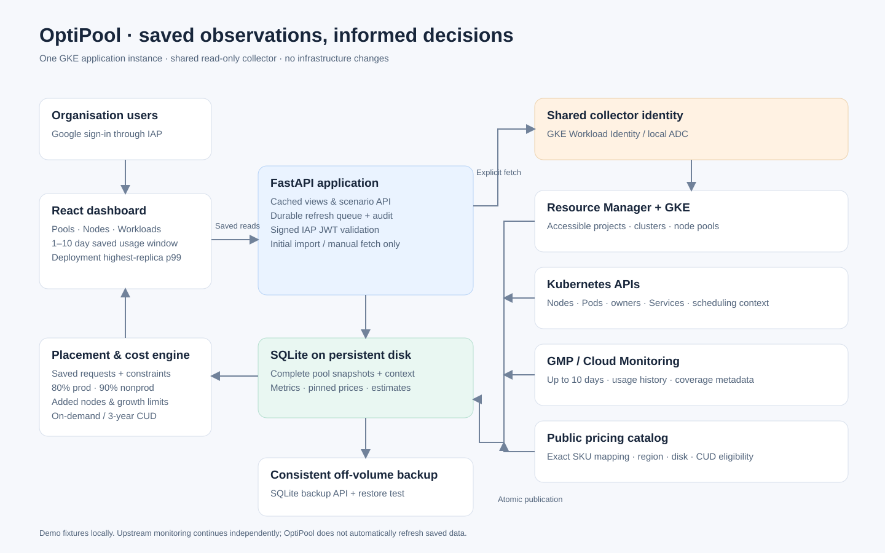
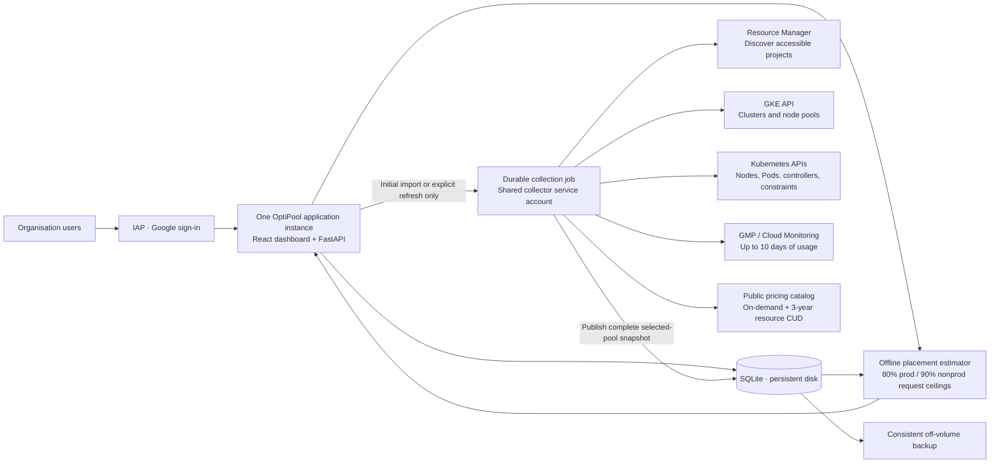

# OptiPool architecture

Browsing, the 1–10 day slider, and estimates use saved observations only. The slider ends at the saved metrics cutoff; it never initiates monitoring queries. Estimates use requested resources and saved placement context. Observed p99 informs request tuning separately.

The collector discovers projects its identity can access using [Resource Manager projects.search](https://docs.cloud.google.com/resource-manager/reference/rest/v3/projects/search). An optional allowlist can restrict discovery. An explicit inventory refresh discovers clusters and pools without replacing existing pool snapshots. Initial startup imports previously unfetched pools; later imports require explicit action.

A selected-pool refresh can read cluster-wide scheduling context but publishes only that pool. A failed core collection preserves the previous snapshot. Monitoring and pricing failures are visible optional enrichment. Duplicate refresh clicks join one durable job.

Production uses GKE Workload Identity for collection and signed IAP assertion validation for browser access. Local demo mode uses synthetic data and loopback-only access. SQLite has one application owner on a durable block volume; Helm uses a single replica with Recreate updates.

The SVG is editable source artwork. It describes the target architecture; deployment and live-cloud validation are separate release checks.
